<h3 align="center">Hi 👋</h3>

Student @42 Paris, building LLM tooling, concurrent backends and clean, playful interfaces. 
Before code, I ran events for a Y Combinator startup and led a 20-person team in Costa Rica 🌴

---

### 🕹️ Currently building
- **[Call Me Maybe](https://github.com/morganespb/call_me_maybe)** — constrained decoding that forces an LLM to output valid function calls
- **RAG against the machine** — Q&A over the vLLM codebase with retrieval-augmented generation
- **TAP** — a multiplayer text-adventure server in Go, built with my team

### 🧰 Stack
`Python` `JavaScript` `Go` `C` `C++` `Rust` `SQL` `Docker` `Linux`

### 📫 Find me
[LinkedIn](https://www.linkedin.com/in/morgane-simon-03832b162) · 

<!--
**morganespb/morganespb** is a ✨ _special_ ✨ repository because its `README.md` (this file) appears on your GitHub profile.

Here are some ideas to get you started:

- 🔭 I’m currently working on ...
- 🌱 I’m currently learning ...
- 👯 I’m looking to collaborate on ...
- 🤔 I’m looking for help with ...
- 💬 Ask me about ...
- 📫 How to reach me: ...
- 😄 Pronouns: ...
- ⚡ Fun fact: ...
-->
